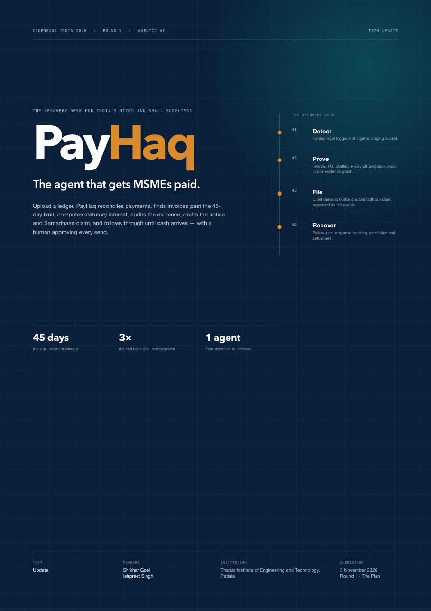
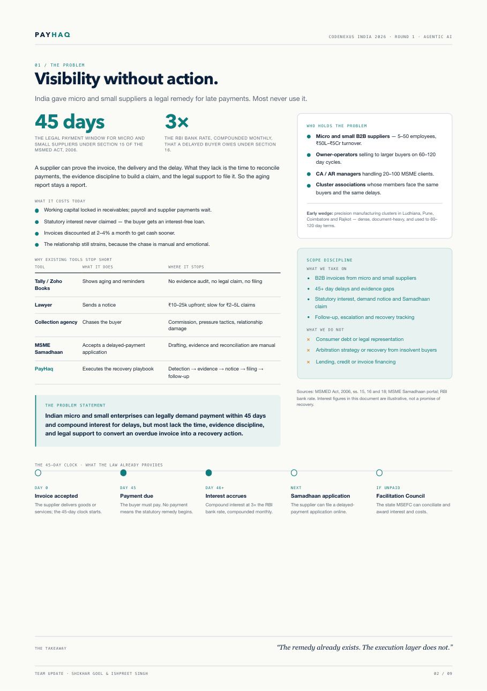
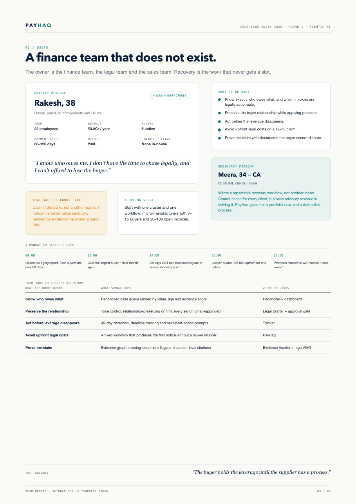
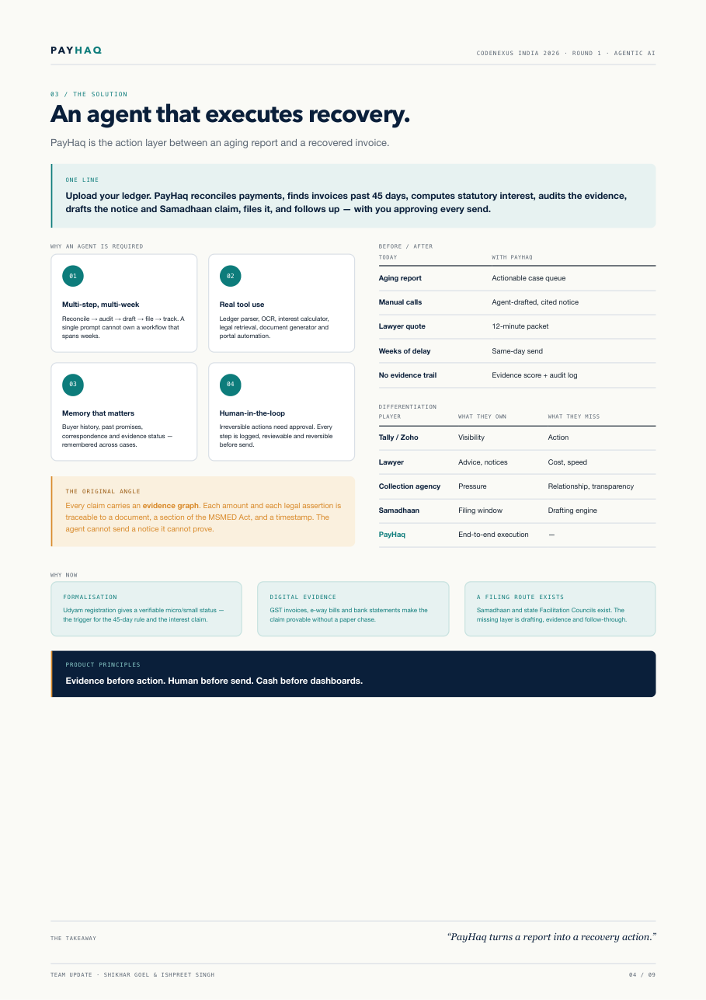
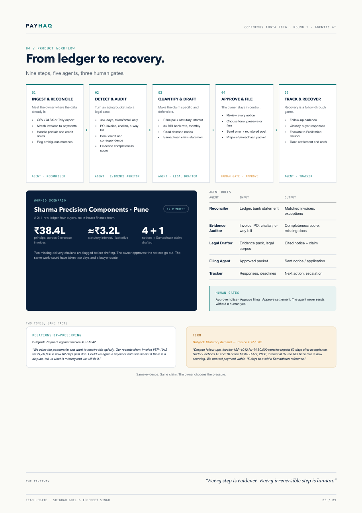
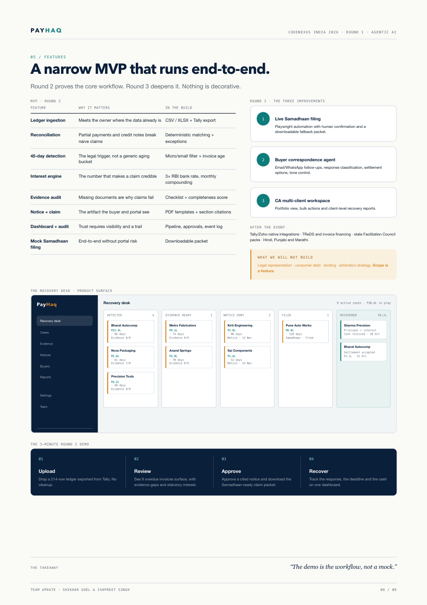
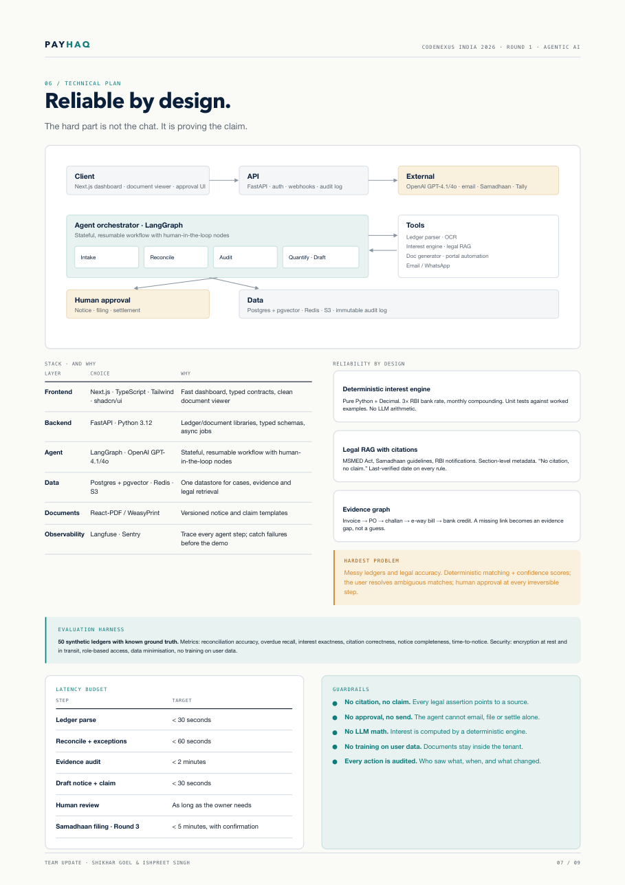
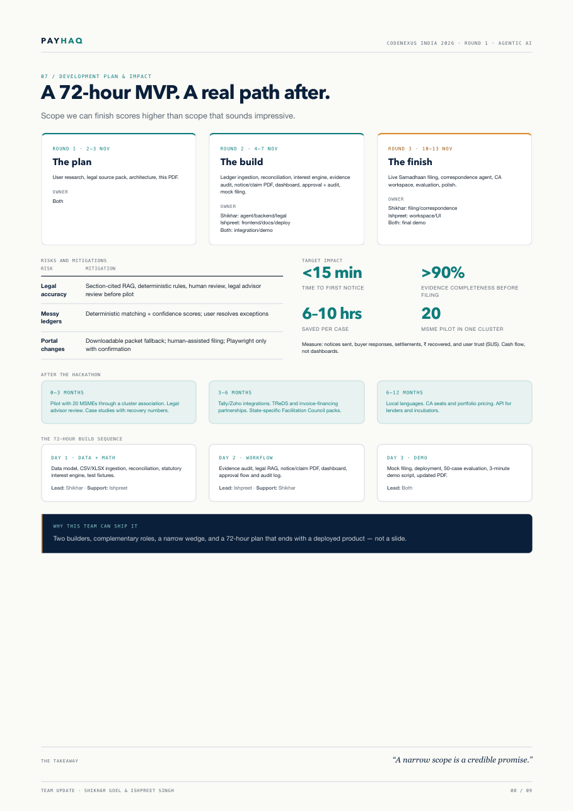
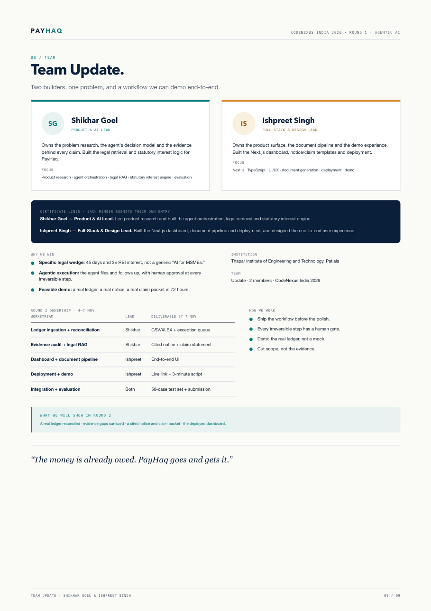

  

# PayHaq
### The agent that gets MSMEs paid.

**CodeNexus India 2026 · Round 1 · Agentic AI**  
**Team Update** — Shikhar Goel & Ishpreet Singh  
Thapar Institute of Engineering and Technology, Patiala

[**Read the Round 1 PDF**](./PayHaq_Round1_TeamUpdate.pdf) · [**Full build log**](./PROCESS.md) · [**Submission text**](./SUBMISSION.md)

---

## What it is

PayHaq is an agentic recovery desk for Indian micro and small suppliers. Upload a ledger; it reconciles payments, finds invoices past the MSMED Act's 45-day limit, computes statutory compound interest, audits the evidence, drafts the demand notice and Samadhaan claim, files it, and tracks recovery — with a human approving every irreversible step.

It is not another dashboard. It is the action layer between an aging report and a recovered invoice.

## The problem

India already gives micro and small suppliers a legal remedy for late payments:

- **45 days** — the maximum payment window under Section 15 of the MSMED Act, 2006.
- **3× the RBI bank rate** — compound interest with monthly rests under Section 16.
- **Samadhaan + MSEFC** — a filing route and state Facilitation Councils under Section 18.

The remedy exists. The execution layer does not. Tally and Zoho show the aging report. A lawyer quotes ₹10–25k for one notice. Collection agencies damage the buyer relationship. The Samadhaan portal accepts an application, but drafting, evidence and reconciliation are manual.

So the aging report stays a report.

## The solution

**Upload a ledger. PayHaq does the recovery work.**

1. **Ingest & reconcile** — CSV/XLSX or Tally export; match invoices to payments and credit notes; flag partial and ambiguous matches.
2. **Detect & audit** — find invoices past 45 days for micro/small suppliers; build the evidence pack (PO, invoice, delivery challan, e-way bill, bank credit, correspondence); score completeness.
3. **Quantify & draft** — compute principal and statutory compound interest at 3× the RBI bank rate; draft a cited demand notice and Samadhaan claim; choose a relationship-preserving or firm tone.
4. **Approve & file** — the owner approves every notice and claim; send by email/registered post; prepare the Samadhaan packet. Live portal filing is the Round 3 improvement.
5. **Track & recover** — follow-up cadence, response classification, escalation to the Facilitation Council, settlement tracking and a recovery dashboard.

### Why an agent is required

The job is multi-step and multi-week, uses real tools (ledger parser, OCR, interest engine, legal retrieval, document generator, portal), needs memory of buyer history and correspondence, and requires a human gate before anything irreversible. A single prompt cannot own that workflow.

### The original angle

Every claim carries an **evidence graph**: each amount and each legal assertion is traceable to a document, a section of the MSMED Act, and a timestamp. The agent cannot send a notice it cannot prove.

## Technical plan

| Layer | Choice | Why |
|---|---|---|
| Frontend | Next.js · TypeScript · Tailwind · shadcn/ui | Fast dashboard, typed contracts, clean document viewer |
| Backend | FastAPI · Python 3.12 | Ledger/document libraries, typed schemas, async jobs |
| Agent | LangGraph · OpenAI GPT-4.1/4o | Stateful, resumable workflow with human-in-the-loop nodes |
| Data | Postgres + pgvector · Redis · S3 | One datastore for cases, evidence and legal retrieval |
| Documents | React-PDF / WeasyPrint | Versioned notice and claim templates |
| Observability | Langfuse · Sentry | Trace every agent step; catch failures before the demo |

**Reliability by design**

- Deterministic interest engine in pure Python + Decimal; no LLM arithmetic.
- Legal RAG over the MSMED Act, Samadhaan guidelines and RBI notifications with section-level citations and a “no citation, no claim” guardrail.
- Evidence graph from invoice → PO → challan → e-way bill → bank credit; missing links become evidence gaps, not guesses.
- Human approval at every irreversible step; immutable audit log.
- 50-case evaluation harness with reconciliation, overdue recall, interest exactness, citation correctness and notice completeness metrics.

## What we build when

**Round 2 (4–7 Nov, 72 hours)**  
Ledger ingestion, reconciliation, 45-day detection, statutory interest engine, evidence audit, notice/claim PDF, pipeline dashboard, approval + audit log, mock Samadhaan filing, deployed demo.

**Round 3 (10–13 Nov, 72 hours)**  
The three named improvements:

1. Live Samadhaan filing via Playwright with human confirmation.
2. Buyer correspondence agent: email/WhatsApp follow-ups, response classification, settlement options, tone control.
3. CA multi-client workspace: portfolio view, bulk actions, client-level recovery reports.

**Out of scope, deliberately:** legal representation, consumer debt, lending, arbitration strategy. Scope is a feature.

## Repository contents

| File | What it is |
|---|---|
| [`PayHaq_Round1_TeamUpdate.pdf`](./PayHaq_Round1_TeamUpdate.pdf) | The final 9-page Round 1 submission |
| [`index.html`](./index.html) | Single-file source for the PDF (HTML/CSS, inline SVG diagrams) |
| [`PROCESS.md`](./PROCESS.md) | The full build log: research, idea exploration, decisions, PDF design and QA |
| [`SUBMISSION.md`](./SUBMISSION.md) | Copy-paste Unstop submission text for both team members |
| [`preview/`](./preview) | Page-by-page PNG previews of the PDF |

## Team

**Shikhar Goel — Product & AI Lead**  
Problem research, agent orchestration, legal retrieval, statutory interest engine, evaluation.

**Ishpreet Singh — Full-Stack & Design Lead**  
Next.js dashboard, document pipeline, deployment, UI/UX, demo.

Both: integration, testing and submission.

## Page previews

Click to open all 9 pages

| | | |
|---|---|---|
|  |  |  |
|  |  |  |
|  |  |  |

---

> PayHaq is a workflow and documentation tool, not a law firm. Legal rules and interest calculations should be verified with a qualified professional before use. The interest figures in the submission are illustrative, not a promise of recovery.
